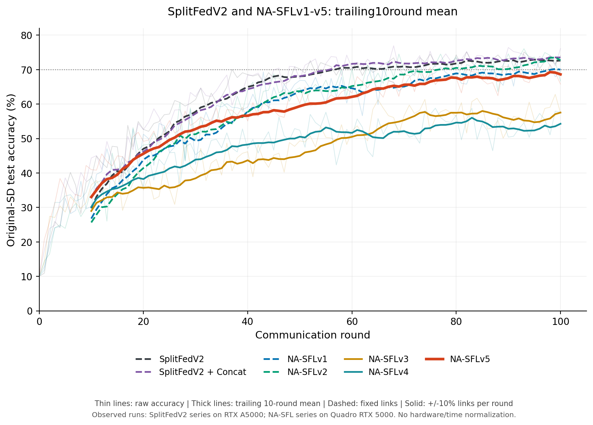
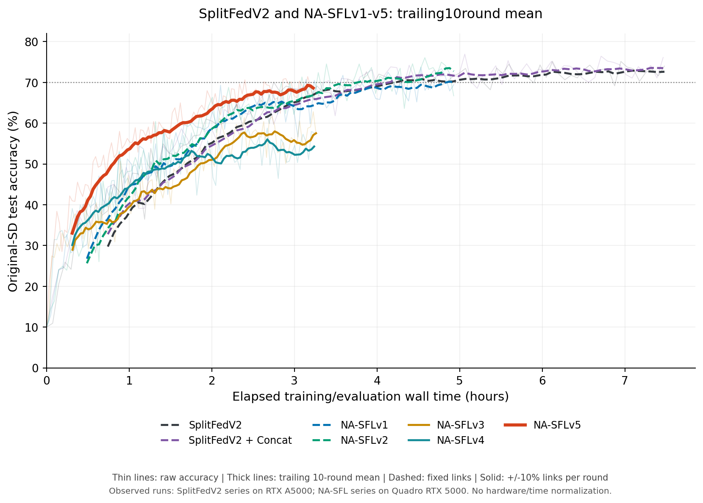
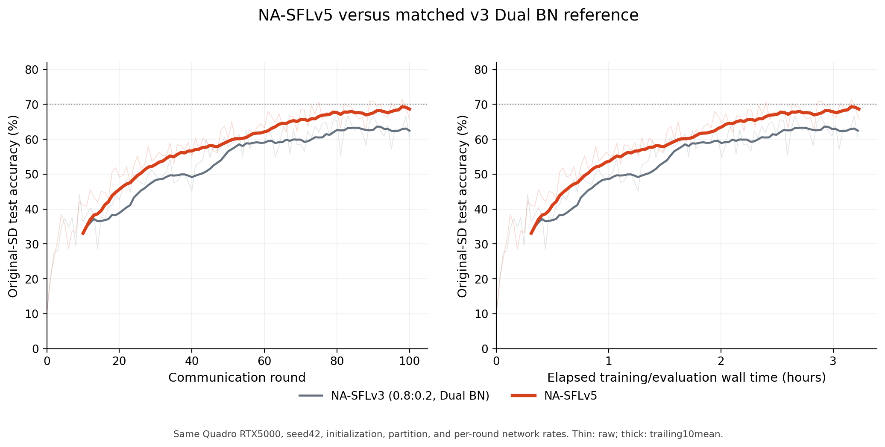
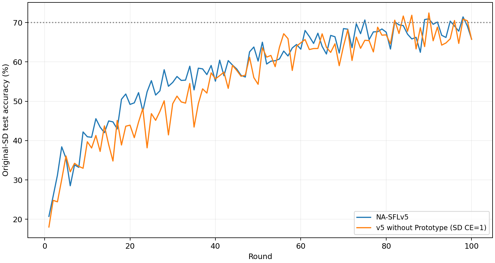

# NA-SFL 프로젝트 진행과 확정 결과

기준 시각: 2026-11-05T17:35:31.461971+09:00. 완료된 원시100round를 CPU로 집계했다. GPU 학습을 새로 실행한 결과가 아니다.

## 현재 코드

SplitFedV2±Concat, NA-SFLv1~v5, v3 Loss/BN, SD-only 비교와 C pipeline을 포함한다.
v5는 Prototype+Random SD10% / Loss0.8:0.2 / DualBN다. C는 그 조건을 유지한2 in-flight/2batch평균누적이다.
**B는 구현·실험하지 않았다.** 각 실험의 진행 상태는 [시각이 명시된 snapshot](../../../reports/20261105_research_summary/status_snapshot.json)이며 C100round는 아직 완료하지 않았다.

## v1~v5 및 SplitFedV2

공통seed42/초기 Client·Server/데이터·분할을 확인했다.
SplitFed두조건은 A5000, NA는 Quadro RTX5000이다. SplitFed/v1/v2는 고정 링크, v3/v4/v5는±10% 변동 링크다.
따라서 wall 차이는 완전히 같은 하드웨어·네트워크의 알고리즘 효과가 아니다.

| 방법 | 최종(%) | 최고(%) | 마지막10평균(%) | 학습~평가 누적초 |
|---|---:|---:|---:|---:|
|SplitFedV2|74.02|75.2|72.628|26924.197749504005|
|SplitFedV2 + Concat|76.13|76.94|73.518|26868.30387104093|
|NA-SFLv1|69.47|73.77|70.005|17748.34409107|
|NA-SFLv2|66.72|76.08|72.738|17742.08477988199|
|NA-SFLv3|57.46|62.83|57.54|11745.100919003948|
|NA-SFLv4|57.67|58.82|54.29|11663.412779869046|
|NA-SFLv5|65.8|71.44|68.633|11622.24404749996|

[비교 CSV](../../../reports/20261105_research_summary/comparison.csv) · [100round 곡선 CSV](../../../reports/20261105_research_summary/round_curves.csv)

주 그래프의 v3는 원본0.5:0.5/공통BN다. v5의 직접 기준선은 별도0.8:0.2/DualBN(마지막10평균62.453%)이며
v5는68.633%(+6.180%p)다. v5의 최초70% crossing은r75/8646.863초이지만 마지막10평균과 최종은70% 미만이다.
TTA는 최초 평가 crossing이며 안정적인 유지 수렴을 뜻하지 않는다.

## Loss·BN 실험

원본v3 마지막10평균57.54%보다0.8:0.2/sharedBN의62.22%가 높아, 두 BN 실험도0.8:0.2를 선택했다.

| 조건 | 최종(%) | 마지막10평균(%) |
|---|---:|---:|
|Loss0.8:0.2 sharedBN|57.06|62.22|
|ProtoBN Freeze|37.22|37.246|
|DualBN|60.44|62.453|

DualBN과 같은 loss/sharedBN 차이는+0.233%p로 단일seed에서 뚜렷한 추가 효과를 입증하지 못했다.
Freeze는 크게 저하했다. Prototype 정보압축·공유BN·목적함수·샘플 다양성은 원인 후보이며 이 표로 인과기여도를 확정하지 않는다.
[BN CSV](../../../reports/20261105_research_summary/bn_loss.csv) · [자동 분기 근거](../../../reports/20261105_research_summary/bn_decision.json)

## 보조 gradient 사용자 수0…10

모든10 Client가 Aux를 학습/FedAvg하고, Aux gradient 사용자 수k만 바꿨다.
이 실행은 Mininet/pacing 비교 전 조건이고 k0도 Aux를 학습하므로 bare SplitFed와 같지 않다.
k0~5는 A5000, k6~10은 RTX5000으로 단일seed 결과다.
[전체11조건 결과](../../../reports/20261105_research_summary/aux_gradient_count.csv)

## v5 idle과 별도 FedOptima 비교

v5 학습 구간은102.302초/round(평가/FedAvg 제외), Fast/Slow idle79.31/79.27%,
Server CUDA 모델 연산 외 시간72.23%(서비스 wall 기준70.61%)다.
Fast는 통신·응답 대기76.41초/round, Slow는 round-end 대기43.61초가 커서 Fast가 뒤에 끝났다.
이 idle은 실제 GPU 전체 utilization 측정값이 아니다.
[v5 idle 수치·정의](../../../reports/20261105_research_summary/v5_idle.json)

환경 일치 FedOptima는 최근10평균>70% 또는5시간 조건에서489개30k-visit 평가·마지막10평균59.075%로
시간 제한에 종료했다. 유한 SD credit1 보완을 포함하며 원본 논문 재현이나 NA와 같은100round 실험이 아니다.
[기록](../../../reports/20261105_research_summary/fedoptima_matched.json) · [외부 source/지원 범위](../09-fedoptima-reference/README.md)

## 재현과 보관

소스/환경/실행 명령은 [실행 문서](../../11-02/03-experiments/README.md), [검증 범위](../../11-02/05-reproducibility/README.md)를 따른다.
보고용 숫자·곡선·그림만 공개하며 데이터/최종모델/전체 Job 로그/source snapshot은 포함하지 않는다.
[입력 hash와 조건](../../../reports/20261105_research_summary/provenance.json)을 보존했다.
단일seed/live FCFS 결과이며 GPU·링크 차이와 update frequency 변경을 구분해 해석한다.

## Prototype 제거 조건100round 완료

2026-11-05 17:28 KST 완료 감사 통과. 같은 GPU/seed/초기값/분할/속도표에서 비교했다.

| 조건 | 최종(%) | 최고(%) | 마지막10평균(%) | 학습~평가초 | 최초70% TTA초 |
|---|---:|---:|---:|---:|---:|
|NA-SFLv5|65.8|71.44|68.633|11622.24404749996|8646.863087469945|
|v5 without Prototype (SD CE=1)|65.72|72.43|67.143|11455.432942061918|9350.42636265501|

SD-only 마지막10평균은v5보다1.490%p 낮았고166.811초 빨랐다. SD 계수0.8→1.0과 Proto 생성/목적/BN 경로 제거가 함께 바뀌므로 정보량만의 인과 효과로 설명하지 않는다. 최고72.43%가 마지막10평균 또는 지속70% 달성을 뜻하지 않는다.

[비교 CSV](../../../reports/20261105_research_summary/sd_only_comparison.csv) · [100round 곡선](../../../reports/20261105_research_summary/sd_only_round_curve.csv).

## C의 실제 Smoke와 본학습

실제 GPU/Mininet2roundSmoke가480Jobs/240ClientSteps/480ServerSteps를검증했고 240개그룹에서Forward(B2)와UL(B1)중첩을확인했다. 시계정렬오차를뺀중첩하한은합계15.608client-seconds다. graph/in-flight최대2, peak allocated10,759,894,528bytes, reserved16,601,055,232bytes다. 이는2round기능검증이며장기안정성/수렴결론이아니다. 본100round는진행중이다. [Smoke수치](../../../reports/20261105_research_summary/c_smoke_audit.json)와시각이기록된status_snapshot.json을참고한다.
