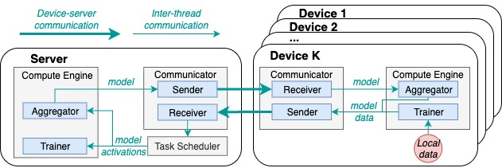

# **FedOptima**: Resource Utilization Optimized Federated Learning

## Introduction

Federated learning (FL) systems facilitate distributed machine learning across a server and multiple devices. However, FL systems have low resource utilization limiting their practical use in the real world. 

This inefficiency primarily arises from two types of idle time: (i) task dependency between the server and devices, and (ii) stragglers among heterogeneous devices. 

This project introduces **FedOptima**, a resource-optimized FL system designed to simultaneously minimize both types of idle time; existing systems do not eliminate or reduce both at the same time. **FedOptima** offloads the training of certain layers of a neural network from a device to server using three innovations. 

1. Devices operate independently of each other using asynchronous aggregation to eliminate straggler effects, and independently of the server by utilizing auxiliary networks to minimize idle time caused by task dependency. 

2. The server performs centralized training using a task scheduler that ensures balanced contributions from all devices, improving model accuracy. 

3. An efficient memory management mechanism on the server increases scalability of the number of participating devices.

<div align=center>

</div>

The above figure shows how devices interact with the server during training in **FedOptima**. Devices and the server operates independently and do not have to wait for each other, thereby minimising idle time.


## Code Instruction

### Environment Setup

This is a Python project and the recommended python version is python3.9.
The dependency required for this project are listed in requirement.txt. You can install the dependency by

```
pip install -r requirements.txt
```

**FedOptima** requires a server and multiple devices. They all need the above environment. If the dataset used is CIFAR-10, it will be downloaded automatically the first time the code is run.

### Configuration

Before running the code, you need to personalise the config.json file. The file is in form of JSON and the meaning of items are listed below.

| Config Item              | Type   | Description                                                                                                                                                                                 |
|--------------------------|--------|---------------------------------------------------------------------------------------------------------------------------------------------------------------------------------------------|
| experiment_name          | string | The name of this experiments, e.g. "test01".                                                                                                                                                |
| server_address           | string | The server IP address.                                                                                                                                                                      |
| port                     | int    | The port of server.                                                                                                                                                                         |
| client_num               | int    | The number of devices involved.                                                                                                                                                             |
| dataset_name             | string | The dataset on which the model is trained. Available datasets include "CIFAR-10", "MNIST" and "SVHN". Other datasets need to be downloaded manually and put into /data/"dataset_name"/      |
| model_name               | string | The deep learning models. Available models include "VGG5"-"VGG19", "ResNet18"-"ResNet152", "MobileNetSmall", "MobileNetLarge", "TransformerSmall", "TransformerMedium", "TransformerLarge". |
| data_size                | int    | The size of training data for each device.                                                                                                                                                  |
| test_data_size           | int    | The size of test data.                                                                                                                                                                      |
| max_val_step             | int    | The maximal number of validation step.                                                                                                                                                      |
| non_improve_step         | int    | The number of validation steps that loss does not reduce before early stop.                                                                                                                 |
| batch_size               | int    | The size of data batch used in each training round.                                                                                                                                         |
| layer_num_on_client      | int    | How many layers deployed at the device side.                                                                                                                                                |
| uplink_bandwidth         | int    | The uplink network bandwidth (Mbps).                                                                                                                                                        |
| downlink_bandwidth       | int    | The downlink network bandwidth (Mbps).                                                                                                                                                      |

### Running the Code

You need to start the project on the server first, and then start the project on devices.

Running on server:

```
python run.py -s
```

where -s means the code is running on server.

Running on device:

```
python run.py -i {device_index}
```

where -i represent the index of current device which starts from 0.

### Results

The results, including model accuracy, training time, idle time, etc., are saved in results/results.csv and also printed on screen.

## Citation

Zihan Zhang, Leon Wong, Blesson Varghese. 2025. “Resource Utilization Optimized Federated Learning.” arXiv preprint arXiv:2504.13850.

```
@misc{zhang2025fedoptima,
  title         = {Resource Utilization Optimized Federated Learning},
  author        = {Zhang, Zihan and Wong, Leon and Varghese, Blesson},
  year          = {2025},
  eprint        = {2504.13850},
  archivePrefix = {arXiv},
  primaryClass  = {cs.DC},
  url           = {https://arxiv.org/abs/2504.13850}
}
```